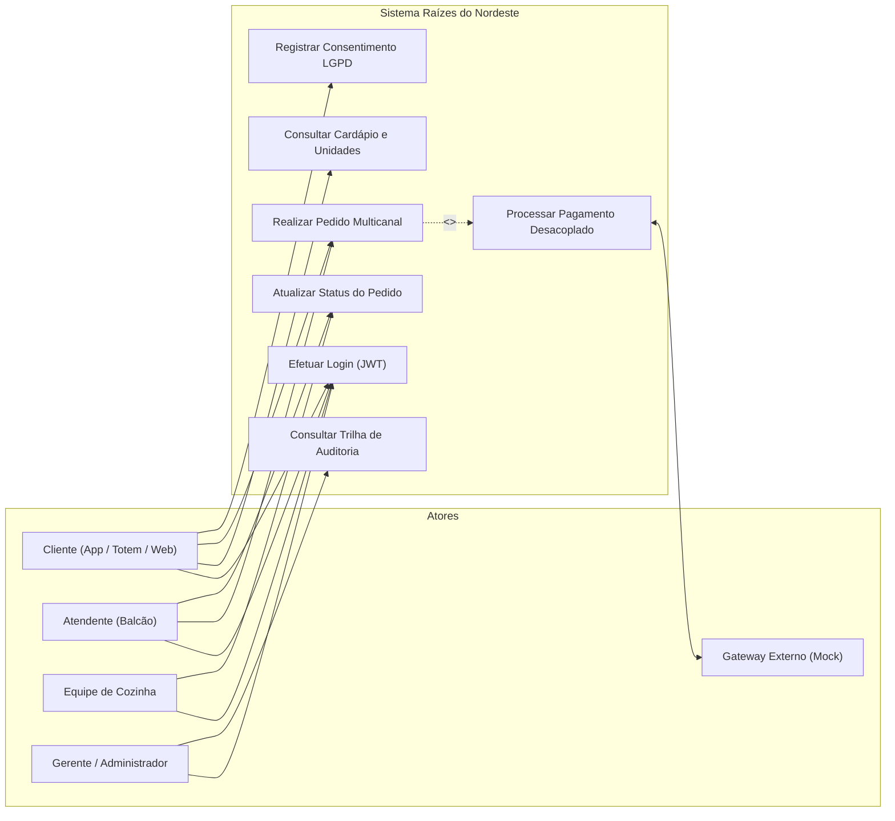
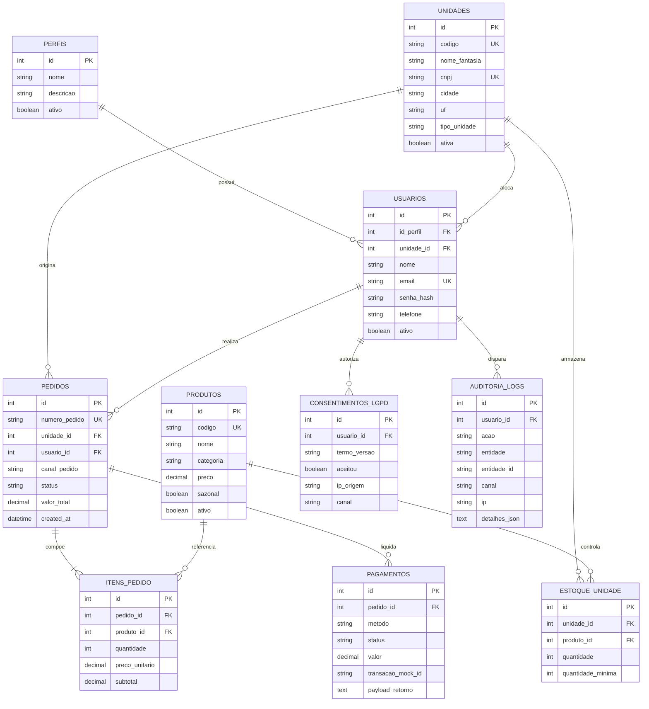
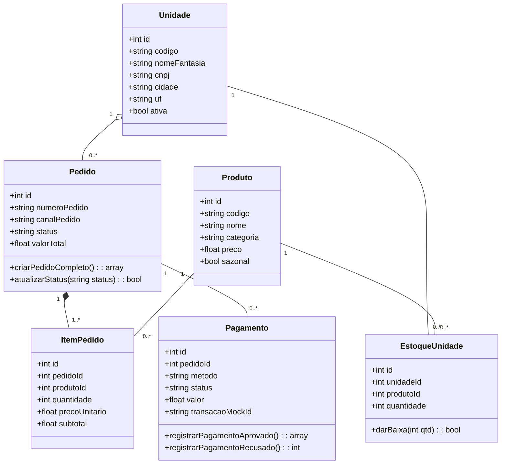
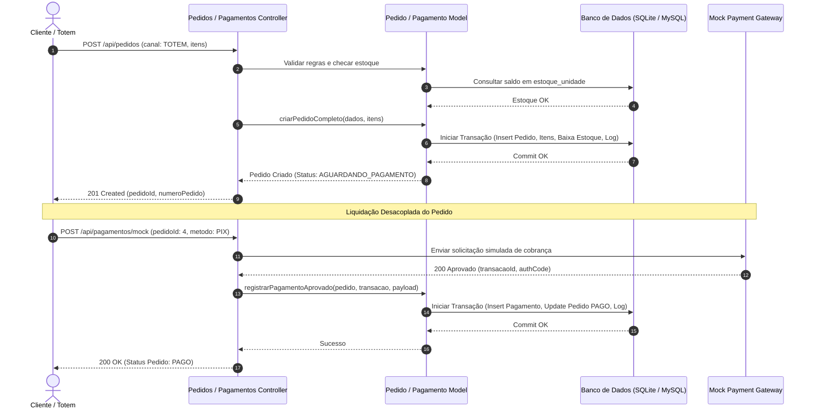

# CENTRO UNIVERSITÁRIO INTERNACIONAL UNINTER
### CURSO SUPERIOR DE TECNOLOGIA EM ANÁLISE E DESENVOLVIMENTO DE SISTEMAS
### DISCIPLINA DE PROJETO MULTIDISCIPLINAR (TRILHA BACK-END)

<br><br><br>

# SISTEMA INTEGRADO DE GESTÃO E PEDIDOS MULTICANAL: REDE DE LANCHONETES "RAÍZES DO NORDESTE"

<br><br><br>

**Aluno:** [SEU NOME COMPLETO]  
**RU:** [SEU RU]  
**Polo de Apoio:** [SEU POLO]  
**Semestre/Ano:** 2026  
**Professores Orientadores:** Prof. Me. Luciane Yanase Kanashiro, Prof. Giuliano Lanes de Almeida, Prof. Rodrigo da Silva do Nascimento, Prof. Winston Sen Lun Fung  

<br><br><br>

**[SUA CIDADE - UF]**  
**2026**

---

\newpage

## SUMÁRIO

1. [INTRODUÇÃO](#1-introdução)  
   1.1. Contextualização do Estudo de Caso  
   1.2. Objetivos do Projeto  
   1.3. Perfis de Usuários e Relevância do Sistema  
2. [ANÁLISE E ENGENHARIA DE REQUISITOS](#2-análise-e-engenharia-de-requisitos)  
   2.1. Contexto Organizacional da Franquia (Matriz vs. Filiais)  
   2.2. Requisitos Funcionais (RF) e Matriz de Priorização (MVP vs. Proposto)  
   2.3. Requisitos Não Funcionais (RNF)  
   2.4. Domínio de Multicanalidade (`canalPedido`)  
   2.5. Conformidade com a LGPD e Privacidade  
3. [MODELAGEM E ARQUITETURA DE SOFTWARE](#3-modelagem-e-arquitetura-de-software)  
   3.1. Diagrama de Casos de Uso (UML)  
   3.2. Descrição Formal da Feature Crítica (Realizar Pedido e Solicitar Pagamento)  
   3.3. Modelo de Dados e Diagrama Entidade-Relacionamento (DER)  
   3.4. Diagrama de Classes do Domínio  
   3.5. Diagrama de Sequência do Fluxo Crítico  
   3.6. Arquitetura em Camadas e Separação de Responsabilidades  
4. [CONTRATOS DE API E ENDPOINTS](#4-contratos-de-api-e-endpoints)  
   4.1. Visão Geral dos Recursos  
   4.2. Padrão Unificado de Respostas de Erro  
   4.3. Especificação dos Contratos Principais  
5. [ENTREGA TÉCNICA E REPRODUTIBILIDADE](#5-entrega-técnica-e-reprodutibilidade)  
   5.1. Repositório e Versionamento Git  
   5.2. Documentação Interativa OpenAPI / Swagger  
   5.3. Guia de Reprodução Local  
6. [PLANO DE TESTES E EVIDÊNCIAS DE EXECUÇÃO](#6-plano-de-testes-e-evidências-de-execução)  
   6.1. Estratégia de Testabilidade e Cobertura  
   6.2. Matriz dos Cenários de Teste (Mínimo de 10 Cenários)  
   6.3. Coleção Automatizada Postman / Insomnia  
7. [CONCLUSÃO](#7-conclusão)  
   7.1. Síntese dos Resultados Alcançados  
   7.2. Desafios de Alta Disponibilidade e Concorrência  
   7.3. Roadmap e Evoluções Futuras  
8. [REFERÊNCIAS BIBLIOGRÁFICAS](#8-referências-bibliográficas)  
9. [DECLARAÇÃO OBRIGATÓRIA DE USO DE INTELIGÊNCIA ARTIFICIAL](#9-declaração-obrigatória-de-uso-de-inteligência-artificial)  

---

\newpage

# 1. INTRODUÇÃO

## 1.1. Contextualização do Estudo de Caso
A rede de lanchonetes "Raízes do Nordeste" nasceu como um pequeno empreendimento familiar tradicional no bairro do Recife Antigo, sob o comando de Dona Francisca e seus dois filhos. Focada em pratos autênticos da gastronomia regional — como cuscuz recheados, tapiocas artesanais, bolo cremoso de macaxeira e cafés passados na hora —, a marca expandiu-se aceleradamente para diversas capitais e cidades do interior do país sob o modelo de franquia.

Contudo, a expansão física desvelou gargalos operacionais e tecnológicos críticos. A coexistência de unidades com portes distintos (matriz com cozinha completa versus quiosques reduzidos), receitas adaptadas sazonalmente (período junino) e canais descentralizados de atendimento exigiram a modernização da infraestrutura de software, consolidando os processos em uma arquitetura de Back-End centralizada, escalável e resiliente.

## 1.2. Objetivos do Projeto
O presente projeto tem por finalidade projetar, documentar e implementar a API RESTful da Rede Raízes do Nordeste, estabelecendo:
1. **Unificação da Jornada Multicanal:** Garantir consistência nas regras de negócio independentemente do canal de entrada (Aplicativo Móvel, Totens de Autoatendimento, Balcão de Loja, Retirada Rápida e Web).
2. **Integração Desacoplada de Pagamentos:** Desenvolver um mock estruturado para simulação de gateways externos com tratamento transacional e tolerância a falhas.
3. **Controle de Estoque Descentralizado:** Assegurar que os pedidos respeitem o saldo físico em tempo real da unidade selecionada, evitando rupturas operacionais.
4. **Governança, Segurança e LGPD:** Aplicar autenticação baseada em tokens (JWT), permissões por perfil (`roles`), registro formal do consentimento do titular e trilha de auditoria para ações sensíveis.

## 1.3. Perfis de Usuários e Relevância do Sistema
O ecossistema atende a múltiplos atores com privilégios delimitados:
* **Cliente Consumidor:** Realiza consultas ao cardápio da unidade, submete pedidos via aplicativo, totem ou web, e acompanha o status de preparo.
* **Atendente de Balcão:** Opera frentes de caixa nas unidades físicas e registra pedidos presenciais.
* **Equipe de Cozinha:** Acompanha o painel de produção e atualiza o ciclo de vida dos pedidos (`EM_PREPARO` $\rightarrow$ `PRONTO`).
* **Gerente da Unidade:** Monitora vendas locais, cancelamentos e níveis de estoque.
* **Administrador da Franqueadora (Matriz):** Configura filiais, cadastra produtos e audita transações corporativas.

---

\newpage

# 2. ANÁLISE E ENGENHARIA DE REQUISITOS

## 2.1. Contexto Organizacional da Franquia (Matriz vs. Filiais)
A franqueadora estabelece governança centralizada com operação local autônoma:
* **Matriz Corporativa:** Detém a gestão do catálogo global de produtos, definição de diretrizes de preços, controle de expansão de novas filiais e auditoria corporativa.
* **Filiais Locais:** Cada unidade opera seu próprio estoque físico, possui colaboradores alocados e responde pelo atendimento imediato ao cliente regional.

## 2.2. Requisitos Funcionais (RF) e Matriz de Priorização (MVP vs. Proposto)
Em conformidade com as diretrizes do edital, os requisitos foram categorizados entre o escopo implementado no MVP e as propostas de roadmap futuro:

| Identificador | Descrição do Requisito Funcional | Categoria | Escopo | Justificativa Técnica da Priorização |
| :---: | :--- | :---: | :---: | :--- |
| **RF01** | Autenticação de usuários via JWT com identificação de perfis (`roles`). | Segurança | **MVP** | Essencial para identificar o usuário e restringir ações administrativas. |
| **RF02** | Consulta de unidades físicas ativas com filtro por UF. | Franquia | **MVP** | Pré-requisito para o cliente selecionar o ponto de consumo. |
| **RF03** | Visualização de cardápio regional integrado ao estoque local da filial. | Catálogo | **MVP** | Permite ao consumidor visualizar a disponibilidade de pratos em tempo real. |
| **RF04** | Criação de pedidos com validação obrigatória do canal (`canalPedido`). | Pedidos | **MVP** | Núcleo do fluxo crítico e exigência indispensável de multicanalidade. |
| **RF05** | Restrição de venda e retorno de erro 409 em caso de estoque insuficiente. | Estoque | **MVP** | Garante consistência física entre vendas e produtos em cozinha. |
| **RF06** | Atualização do ciclo de status do pedido (`AGUARDANDO_PAGAMENTO` a `ENTREGUE`). | Operação | **MVP** | Necessário para sincronização entre frente de loja e cozinha. |
| **RF07** | Processamento desacoplado de pagamento simulado (Mock Gateway). | Pagamentos | **MVP** | Demonstra aprovação e recusa sem dependência de serviços externos reais. |
| **RF08** | Registro formal de consentimento explícito do cliente conforme a LGPD. | Privacidade | **MVP** | Cumprimento mandatório do Art. 7º, I da Lei 13.709/2018. |
| **RF09** | Trilha de auditoria para operações sensíveis e financeiras. | Auditoria | **MVP** | Atende ao requisito de conformidade e governança da franquia. |
| **RF10** | Programa de fidelização com acúmulo de pontos progressivos e resgate. | Fidelidade | Proposto | Módulo expansível para segunda etapa da transformação digital. |
| **RF11** | Gestão de cardápio sazonal unificado para o período junino. | Marketing | Proposto | Planejado para campanhas periódicas coordenadas pela matriz. |

## 2.3. Requisitos Não Funcionais (RNF)

* **RNF01 — Padrão Arquitetural RESTful:** A API deve adotar verbos HTTP semânticos (`GET`, `POST`, `PATCH`), URLs no plural, paginação em listagens e identificadores no path.
* **RNF02 — Segurança e Criptografia:** Senhas de acesso devem ser armazenadas com função de derivação de chave de via única `bcrypt` (fator de custo 10 ou superior). Dados confidenciais nunca devem trafegar em respostas JSON.
* **RNF03 — Padronização de Erros:** Todas as respostas com status HTTP 4xx e 5xx devem retornar uma estrutura JSON unificada com as chaves `error`, `message`, `details`, `timestamp` e `path`.
* **RNF04 — Desempenho e Disponibilidade em Picos:** A API deve ser stateless, desacoplando o processamento de pagamentos para não gerar gargalos síncronos na camada web em horários de pico.
* **RNF05 — Integridade e Atomicidade (ACID):** Operações que envolvem criação de pedido, redução de estoque e registro financeiro devem ser executadas sob transações atômicas no banco de dados.

## 2.4. Domínio de Multicanalidade (`canalPedido`)
A solução atende múltiplos canais de venda sem duplicação de regras de negócio. O campo `canal_pedido` foi modelado como um dado de primeira classe do domínio (`ENUM`), com os seguintes valores aceitos:
* `APP`: Pedidos efetuados via aplicativo mobile com retirada programada.
* `TOTEM`: Terminais de autoatendimento instalados dentro do salão da loja física.
* `BALCAO`: Atendimento tradicional com operador de caixa.
* `PICKUP`: Pedidos antecipados para coleta imediata em balcão dedicado.
* `WEB`: Pedidos via navegador web.

A API valida compulsoriamente a presença deste campo na criação do pedido (`POST /api/pedidos`) e permite a filtragem de relatórios gerenciais por canal (`GET /api/pedidos?canalPedido=TOTEM`).

## 2.5. Conformidade com a LGPD e Privacidade
Em atendimento ao Art. 7º, I da Lei Geral de Proteção de Dados (Lei nº 13.709/2018), o sistema implementa:
1. **Base Legal e Consentimento:** Armazenamento em tabela dedicada (`consentimentos_lgpd`) registrando versão do termo, aceite booleano, finalidade expressa, IP e canal de origem.
2. **Minimização de Dados:** Coleta estrita dos dados necessários à execução contratual (nome, e-mail, telefone).
3. **Não Exposição:** O hash de credenciais e dados privados são completamente isolados e omitidos das respostas da API.

---

\newpage

# 3. MODELAGEM E ARQUITETURA DE SOFTWARE

## 3.1. Diagrama de Casos de Uso (UML)
O diagrama a seguir sintetiza as interações entre os atores do ecossistema e os principais casos de uso da API:



## 3.2. Descrição Formal da Feature Crítica (Realizar Pedido e Solicitar Pagamento)
Conforme modelo preconizado no anexo do roteiro de atividades práticas:

* **Caso de Uso:** UC01 — Realizar Pedido Multicanal e Processar Pagamento Mock.
* **Ator Principal:** Cliente Consumidor / Atendente de Balcão.
* **Atores Secundários:** Mock Gateway de Pagamento, Sistema de Auditoria.
* **Pré-condições:**
  1. Unidade física deve estar com status ativa no sistema;
  2. Produtos solicitados devem estar cadastrados e com saldo de estoque suficiente na unidade informada;
  3. Usuário autenticado ou devidamente identificado.
* **Pós-condições:**
  1. Pedido registrado com status `PAGO` (em caso de aprovação) ou `AGUARDANDO_PAGAMENTO` (em caso de pendência);
  2. Saldo de estoque da unidade decrementado no quantitativo exato;
  3. Transação bancária registrada na tabela `pagamentos`;
  4. Trilha de auditoria gerada com endereço IP e canal de origem.
* **Fluxo Principal:**
  1. O cliente seleciona a unidade e inclui itens no carrinho via App, Totem ou Web;
  2. O cliente submete a requisição `POST /api/pedidos` informando obrigatoriamente `canalPedido`, `unidadeId` e a lista de itens com quantidades;
  3. O sistema valida os campos, confere os preços unitários e verifica se há saldo em estoque na unidade;
  4. O sistema abre transação atômica no banco, gera o número sequencial (`PED-2026-XXXX`), insere o pedido, grava os itens e deduz o estoque;
  5. O cliente submete a chamada `POST /api/pagamentos/mock` com o `pedidoId` e o método desejado (`PIX`);
  6. O serviço externo simulado processa a requisição e retorna aprovação com código de autorização;
  7. O sistema atualiza o status do pedido para `PAGO` e grava o registro na trilha de auditoria;
  8. O sistema retorna HTTP 200 OK com o recibo digital da operação.
* **Fluxos Alternativos e Exceções:**
  * **Exceção 1 (Canal Ausente):** Se `canalPedido` não for enviado, o sistema rejeita a requisição imediatamente com código HTTP 422 (`VALOR_INVALIDO`).
  * **Exceção 2 (Estoque Insuficiente):** Se a quantidade solicitada for maior que o saldo na filial, o sistema aborta a operação com código HTTP 409 (`ESTOQUE_INSUFICIENTE`), informando a quantidade máxima disponível.
  * **Exceção 3 (Pagamento Recusado):** Caso o simulador retorne recusa bancária, a transação é persistida com status `RECUSADO`, o pedido permanece em aberto e o sistema retorna HTTP 409 informando o motivo da operadora.

## 3.3. Modelo de Dados e Diagrama Entidade-Relacionamento (DER)
A base de dados foi modelada em terceira forma normal (3FN), com integridade referencial por chaves estrangeiras:



## 3.4. Diagrama de Classes do Domínio
Representação orientada a objetos das principais entidades do sistema:



## 3.5. Diagrama de Sequência do Fluxo Crítico
Demonstração da interação síncrona/desacoplada durante a criação e pagamento do pedido:



## 3.6. Arquitetura em Camadas e Separação de Responsabilidades
Para garantir alta manutenibilidade e aderência aos princípios do SOLID e Clean Architecture, o projeto foi estritamente segregado:
1. **Camada de Apresentação / API (`app/Controllers/Api/`):** Recepciona as requisições HTTP, realiza validações superficiais de payload e tipos de dados, aciona a camada de modelo e devolve códigos de status HTTP semânticos (200, 201, 401, 404, 409, 422). Nenhum controller gerencia transações de banco diretamente.
2. **Camada de Domínio e Aplicação (`app/Models/`):** Centraliza as regras de negócio complexas, transações ACID (`transStart` / `transComplete`), integridade referencial, queries de junção (`JOIN`) e emissão automática da trilha de auditoria.
3. **Camada de Suporte Cruzado (`app/Helpers/`):** O `script_helper.php` padroniza o contrato de erro da API para todas as rotas do ecossistema.
4. **Camada de Persistência (`app/Database/`):** Migrações declarativas e seeders de dados para provisionamento determinístico do banco.

---

\newpage

# 4. CONTRATOS DE API E ENDPOINTS

## 4.1. Visão Geral dos Recursos

| Método | Rota | Autenticação | Finalidade Operacional |
| :---: | :--- | :---: | :--- |
| `POST` | `/api/auth/login` | Pública | Autentica usuário via e-mail/senha e gera Token JWT com perfil (`role`). |
| `GET` | `/api/auth/me` | Bearer Token | Retorna os dados cadastrais e permissões do usuário autenticado. |
| `GET` | `/api/unidades` | Pública | Lista todas as filiais e matriz com filtro opcional por estado (`?uf=PE`). |
| `GET` | `/api/unidades/{id}` | Pública | Detalha os dados de uma unidade física. Retorna 404 se não existir. |
| `GET` | `/api/produtos` | Pública | Cardápio de produtos com filtro de categoria e saldo de estoque por unidade. |
| `GET` | `/api/produtos/{id}` | Pública | Detalha informações de um item específico do cardápio. |
| `POST` | `/api/pedidos` | Bearer Token | Cria pedido validando itens, estoque local e o campo obrigatório `canalPedido`. |
| `GET` | `/api/pedidos` | Bearer Token | Consulta pedidos com suporte a filtros de multicanalidade (`?canalPedido=TOTEM`). |
| `GET` | `/api/pedidos/{id}` | Bearer Token | Detalha um pedido e todos os seus itens associados. |
| `PATCH` | `/api/pedidos/{id}/status` | Bearer Token | Atualiza o ciclo de vida do pedido (`EM_PREPARO`, `PRONTO`) com auditoria. |
| `POST` | `/api/pagamentos/mock` | Pública/Token | Simula o gateway de pagamento com cenários de sucesso e recusa. |
| `POST` | `/api/lgpd/consentimento` | Pública/Token | Registra o consentimento do titular dos dados para fins de conformidade. |
| `GET` | `/api/auditoria/logs` | Admin / Gerente | Consulta a trilha de auditoria e governança de operações sensíveis. |

## 4.2. Padrão Unificado de Respostas de Erro
Conforme diretriz do edital, toda falha ou exceção segue a mesma assinatura JSON:

```json
{
  "error": "ESTOQUE_INSUFICIENTE",
  "message": "Não há quantidade suficiente para um ou mais itens.",
  "details": [
    {
      "field": "itens[0].quantidade",
      "issue": "Disponível: 1"
    }
  ],
  "timestamp": "2026-11-01T19:28:46Z",
  "path": "api/pedidos"
}
```

## 4.3. Especificação dos Contratos Principais

### Criação de Pedido (`POST /api/pedidos`)
* **Requisição:**
```json
{
  "canalPedido": "TOTEM",
  "unidadeId": 1,
  "usuarioId": 5,
  "itens": [
    { "produtoId": 1, "quantidade": 2 },
    { "produtoId": 2, "quantidade": 1 }
  ],
  "observacoes": "Manteiga caprichada"
}
```
* **Resposta (201 Created):**
```json
{
  "pedidoId": 4,
  "numeroPedido": "PED-2026-0004",
  "status": "AGUARDANDO_PAGAMENTO",
  "canalPedido": "TOTEM",
  "total": 46.90,
  "itens": [
    { "produtoId": 1, "nome": "Cuscuz Tradicional com Manteiga de Garrafa", "quantidade": 2, "precoUnitario": 12.00, "subtotal": 24.00 },
    { "produtoId": 2, "nome": "Cuscuz Sertanejo Especial Recheado", "quantidade": 1, "precoUnitario": 22.90, "subtotal": 22.90 }
  ],
  "createdAt": "2026-11-01T19:28:59Z"
}
```

### Processamento de Pagamento Mock (`POST /api/pagamentos/mock`)
* **Requisição:**
```json
{
  "pedidoId": 4,
  "metodo": "PIX",
  "simulacao": "APROVADO"
}
```
* **Resposta (200 OK):**
```json
{
  "message": "Pagamento aprovado e pedido atualizado para PAGO!",
  "pedidoId": 4,
  "numeroPedido": "PED-2026-0004",
  "statusPedido": "PAGO",
  "pagamento": {
    "id": 5,
    "transacaoMockId": "MOCK-APP-E43EAFA8-20261102",
    "authorizationCode": "AUTH-468742",
    "metodo": "PIX",
    "valor": 46.90,
    "status": "APROVADO",
    "pagoEm": "2026-11-02T16:53:25Z"
  }
}
```

---

\newpage

# 5. ENTREGA TÉCNICA E REPRODUTIBILIDADE

## 5.1. Repositório e Versionamento Git
O código-fonte completo está hospedado em repositório público no GitHub, com histórico linear demonstrando a evolução de cada etapa:
* **Link Público do Repositório:** `https://github.com/kauanpscode/raizes-api`
* *(Aviso crítico: o repositório é público e acessível sem restrições ou exigência de autenticação).*

## 5.2. Documentação Interativa OpenAPI / Swagger
A documentação da API foi anotada nativamente via atributos PHP 8 (`#[OA\...]`) e compilada:
* **Interface Swagger UI:** `http://localhost:8080/swagger/index.html`
* **Arquivo de Definição OpenAPI:** `http://localhost:8080/swagger.json` (ou no repositório em `public/swagger.json`).

## 5.3. Guia de Reprodução Local
Para que a comissão avaliadora reproduza o projeto de forma idêntica:
```bash
# 1. Clonar repositório
git clone https://github.com/kauanpscode/raizes-api.git
cd raizes-api

# 2. Instalar dependências
composer install

# 3. Preparar arquivo de ambiente
cp .env.example .env

# 4. Executar migrações do banco de dados SQLite
php spark migrate

# 5. Popular o banco com dados de teste
php spark db:seed DatabaseSeeder

# 6. Iniciar a API localmente
php spark serve --port 8080
```

---

\newpage

# 6. PLANO DE TESTES E EVIDÊNCIAS DE EXECUÇÃO

## 6.1. Estratégia de Testabilidade e Cobertura
Para atestar o pleno funcionamento do sistema e atender às exigências de avaliação (mínimo de 10 cenários, com pelo menos 6 positivos e 4 negativos cobrindo 401, 404, 409, 422 e regra de pagamento recusado), foi construída uma suíte com **18 cenários automatizados**.

## 6.2. Matriz dos Cenários de Teste

| ID | Cenário de Teste | Método + Endpoint | Pré-condição | Entrada (Payload / Parâmetros) | Saída Esperada (Status + Response) | Evidência na Coleção |
| :---: | :--- | :--- | :--- | :--- | :--- | :--- |
| **T01** | Autenticação com credenciais válidas *(Positivo)* | `POST /api/auth/login` | Usuário ativo no seed | `{"email": "admin@raizesdonordeste.com.br", "senha": "Admin@123"}` | `200 OK` + `accessToken` JWT + role ADMIN | `1. Autenticação / T01 - Login Válido` |
| **T02** | Login com senha incorreta *(Negativo)* | `POST /api/auth/login` | Usuário existente | `{"email": "admin@raizesdonordeste.com.br", "senha": "errada"}` | `401 Unauthorized` (`CREDENCIAIS_INVALIDAS`) | `1. Autenticação / T02 - Login com Senha Incorreta` |
| **T03** | Login sem informar campos obrigatórios *(Negativo)* | `POST /api/auth/login` | Nenhuma | `{"email": ""}` | `422 Unprocessable` (`CAMPOS_OBRIGATORIOS_AUSENTES`) | `1. Autenticação / T03 - Login sem Campos` |
| **T04** | Acesso a rota protegida com Bearer Token *(Positivo)* | `GET /api/auth/me` | Usuário autenticado | Header `Authorization: Bearer <token>` | `200 OK` + dados cadastrais do titular | `1. Autenticação / T04 - Acesso com Bearer Token` |
| **T05** | Listar unidades ativas da franquia *(Positivo)* | `GET /api/unidades` | Banco populado | Nenhuma | `200 OK` + lista de unidades (Recife, Salvador, Fortaleza) | `2. Unidades / T05 - Listar Todas as Unidades` |
| **T06** | Buscar unidade física inexistente *(Negativo)* | `GET /api/unidades/9999` | Nenhuma | ID 9999 no path | `404 Not Found` (`UNIDADE_NAO_ENCONTRADA`) | `2. Unidades / T06 - Buscar Unidade Inexistente` |
| **T07** | Listar cardápio com estoque por filial *(Positivo)* | `GET /api/produtos?unidadeId=1` | Unidade existente | `?unidadeId=1` | `200 OK` + itens com `quantidade_estoque` | `3. Cardápio / T07 - Listar Cardápio com Estoque` |
| **T08** | Detalhar produto existente *(Positivo)* | `GET /api/produtos/1` | Produto ativo | ID 1 no path | `200 OK` + dados do Cuscuz Tradicional | `3. Cardápio / T08 - Detalhes do Produto` |
| **T09** | Criar pedido com canal e estoque válido *(Positivo)* | `POST /api/pedidos` | Itens e estoque OK | `{"canalPedido": "TOTEM", "unidadeId": 1, "itens": [...]}` | `201 Created` + `pedidoId` + status `AGUARDANDO_PAGAMENTO` | `4. Pedidos / T09 - Criar Pedido com Canal` |
| **T10** | Criar pedido sem campo `canalPedido` *(Negativo)* | `POST /api/pedidos` | Nenhuma | Payload sem `canalPedido` | `422 Unprocessable` (`VALOR_INVALIDO`) | `4. Pedidos / T10 - Criar sem canalPedido` |
| **T11** | Criar pedido com quantidade acima do estoque *(Negativo)* | `POST /api/pedidos` | Saldo insuficiente | Item com quantidade = 999 | `409 Conflict` (`ESTOQUE_INSUFICIENTE` + disponível) | `4. Pedidos / T11 - Estoque Insuficiente` |
| **T12** | Filtrar pedidos por canal de atendimento *(Positivo)* | `GET /api/pedidos?canalPedido=TOTEM` | Pedidos criados | `?canalPedido=TOTEM` | `200 OK` + apenas pedidos originados no Totem | `4. Pedidos / T12 - Filtrar por canal TOTEM` |
| **T13** | Atualizar status do pedido para preparo *(Positivo)* | `PATCH /api/pedidos/{id}/status` | Pedido em aberto | `{"status": "EM_PREPARO"}` | `200 OK` + status alterado + log de auditoria | `4. Pedidos / T13 - Atualizar Status do Pedido` |
| **T14** | Pagamento recusado pela operadora *(Negativo)* | `POST /api/pagamentos/mock` | Pedido existente | `{"pedidoId": 2, "simulacao": "RECUSADO"}` | `409 Conflict` (`PAGAMENTO_RECUSADO` + transação) | `5. Pagamentos / T14 - Pagamento Mock Recusado` |
| **T15** | Pagamento aprovado via PIX *(Positivo)* | `POST /api/pagamentos/mock` | Pedido em aberto | `{"pedidoId": 2, "simulacao": "APROVADO"}` | `200 OK` + pedido atualizado para `PAGO` | `5. Pagamentos / T15 - Pagamento Mock Aprovado` |
| **T16** | Tentar pagar pedido que já foi quitado *(Negativo)* | `POST /api/pagamentos/mock` | Pedido já pago | `{"pedidoId": 2, "simulacao": "APROVADO"}` | `409 Conflict` (`PAGAMENTO_JA_CONFIRMADO`) | `5. Pagamentos / T16 - Pagar Pedido Quitado` |
| **T17** | Registro de consentimento LGPD *(Positivo)* | `POST /api/lgpd/consentimento` | Usuário existente | `{"usuarioId": 5, "aceitou": true, "canal": "APP"}` | `201 Created` + confirmação de base legal | `6. LGPD / T17 - Registrar Consentimento LGPD` |
| **T18** | Consulta à trilha de governança e logs *(Positivo)* | `GET /api/auditoria/logs` | Logs registrados | `?limit=10` | `200 OK` + histórico de ações sensíveis | `6. LGPD / T18 - Consultar Trilha de Auditoria` |

## 6.3. Coleção Automatizada Postman / Insomnia
A suíte completa está versionada no repositório oficial no arquivo:
* [`docs/raizes_nordeste_postman_collection.json`](https://github.com/kauanpscode/raizes-api/blob/main/docs/raizes_nordeste_postman_collection.json)

---

\newpage

# 7. CONCLUSÃO

## 7.1. Síntese dos Resultados Alcançados
O projeto multidisciplinar atingiu integralmente seus objetivos de engenharia de software ao estruturar uma solução completa para a Rede Raízes do Nordeste. A API implementada demonstrou maturidade técnica ao resolver os principais desafios do negócio:
* **Separação Rigorosa de Responsabilidades:** Eliminação de dependências cruzadas entre controllers e banco de dados, alocando a lógica transacional e de integridade nas models correspondentes.
* **Multicanalidade Nativa:** Tratamento uniforme do ciclo de pedidos originados em múltiplos pontos de contato (`canalPedido`), permitindo rastreabilidade e métricas de desempenho para a franqueadora.
* **Segurança e Privacidade na Prática:** Autenticação stateless por JWT, encriptação com bcrypt, registro de consentimento formal segundo a LGPD e auditoria de ações sensíveis.

## 7.2. Desafios de Alta Disponibilidade e Concorrência
Durante o ciclo de desenvolvimento, evidenciou-se a necessidade de mitigar concorrência em horários de pico (como almoço e fins de semana). A estratégia de isolamento do gateway simulado impediu que lentidões bancárias externas bloqueassem as requisições de frente de loja. Adicionalmente, as transações atômicas de banco de dados garantiram que nenhum produto fosse vendido com quantidade negativa em momentos de compras simultâneas no aplicativo e totem.

## 7.3. Roadmap e Evoluções Futuras
Para os próximos passos de expansão corporativa, destacam-se:
1. **Implantação de Filas Assíncronas (Message Broker):** Adoção de RabbitMQ ou Redis para notificação imediata do painel de cozinha (KDS - Kitchen Display System) via WebSockets;
2. **Clusterização de Banco de Dados:** Replicação leitura/escrita para suportar o crescimento das franquias nas regiões Norte e Centro-Oeste;
3. **Módulo de Fidelidade Gamificado:** Ativação dos endpoints de resgate de pontos para clientes frequentes.

---

\newpage

# 8. REFERÊNCIAS BIBLIOGRÁFICAS

* BRASIL. **Lei nº 13.709, de 14 de agosto de 2018**. Dispõe sobre o tratamento de dados pessoais, inclusive nos meios digitais (Lei Geral de Proteção de Dados Pessoais - LGPD). Diário Oficial da União: seção 1, Brasília, DF, 15 ago. 2018.
* CODEIGNITER FOUNDATION. **CodeIgniter 4 User Guide: Models, Controllers and Database Transactions**. Disponível em: <https://codeigniter.com/user_guide/>. Acesso em: 25 out. 2026.
* FIELDING, Roy Thomas. **Architectural Styles and the Design of Network-based Software Architectures**. Tese (Doutorado em Ciência da Computação) — University of California, Irvine, 2000.
* OPENAPI INITIATIVE. **OpenAPI Specification v3.0.3**. Disponível em: <https://spec.openapis.org/oas/v3.0.3>. Acesso em: 26 out. 2026.
* PRESSMAN, Roger S.; MAXIM, Bruce R. **Engenharia de Software: Uma Abordagem Profissional**. 8. ed. Porto Alegre: AMGH, 2016.
* SOMMERVILLE, Ian. **Engenharia de Software**. 10. ed. São Paulo: Pearson Education do Brasil, 2019.

---

\newpage

# 9. DECLARAÇÃO OBRIGATÓRIA DE USO DE INTELIGÊNCIA ARTIFICIAL

Em estrita conformidade com as diretrizes avaliativas da disciplina de Projeto Multidisciplinar (ano 2026), declara-se que ferramentas de inteligência artificial generativa foram utilizadas exclusivamente como recurso auxiliar de suporte ao estudo, revisão textual e estruturação documental, sem substituição do raciocínio analítico, tomada de decisão técnica ou autoria do estudante.

### 9.1. Ferramenta Utilizada
* **Identificação:** Google Antigravity / Gemini 3.8.
* **Finalidade:** Suporte metodológico, revisão gramatical/ortográfica de parágrafos técnicos, formatação de tabelas acadêmicas conforme normas da ABNT e sugestão de referências bibliográficas normativas.

### 9.2. Prompts Submetidos e Objetivos Pedagógicos
1. **Revisão e Adequação Textual:**
   * *Prompt:* "Atue como revisor acadêmico. Revise a concordância verbal, clareza e coesão dos parágrafos da introdução e conclusão deste relatório de Back-End, mantendo o vocabulário técnico de Engenharia de Software."
   * *Objetivo:* Garantir padrão culto da língua portuguesa e clareza na redação técnica formal.
2. **Estruturação de Tópicos e Normas ABNT:**
   * *Prompt:* "Quais são as seções e elementos pré-textuais obrigatórios segundo o modelo da ABNT para trabalhos de tecnologia da UNINTER?"
   * *Objetivo:* Organizar o sumário, numeração progressiva e paginação conforme as normas institucionais.
3. **Esclarecimento Conceitual e Referências:**
   * *Prompt:* "Explique a diferença técnica entre os status codes HTTP 400, 409 e 422 em APIs RESTful e recomende literatura acadêmica sobre Engenharia de Software."
   * *Objetivo:* Aprofundamento conceitual para fundamentação teórica dos requisitos e da estratégia de testes.

### 9.3. Trechos Aproveitados e Escopo de Aplicação
* **Aproveitamento Textual:** O auxílio da ferramenta limitou-se ao polimento da redação nas seções textuais (Introdução, Conclusão e formulação textual dos cenários de teste na Tabela de Casos de Teste), bem como à indicação das referências bibliográficas clássicas (Pressman e Sommerville).
* **Autoria e Evidências Técnicas:** A concepção arquitetural, modelagem do banco de dados relacional (DER), diagrama de classes, desenvolvimento do código-fonte em PHP 8.2/CodeIgniter 4, configuração do SQLite, rotas da API, coleção automatizada no Postman e testes executados no servidor local foram integralmente concebidos e operados pelo aluno, conforme evidenciado no histórico de commits do repositório Git vinculado.
